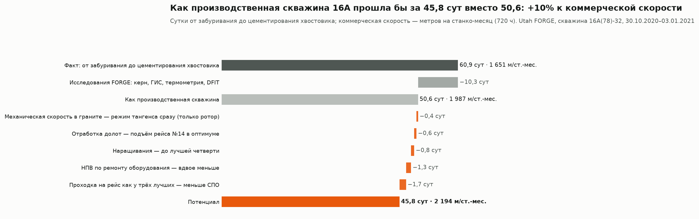
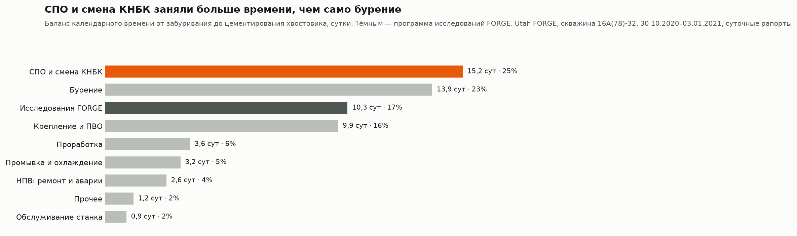
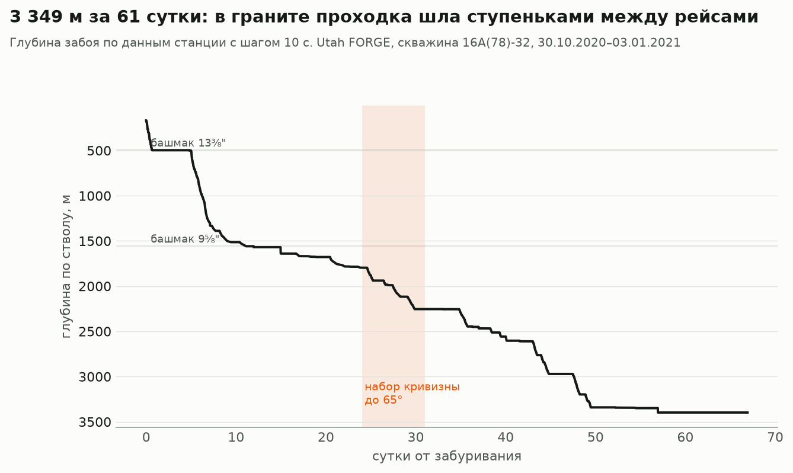
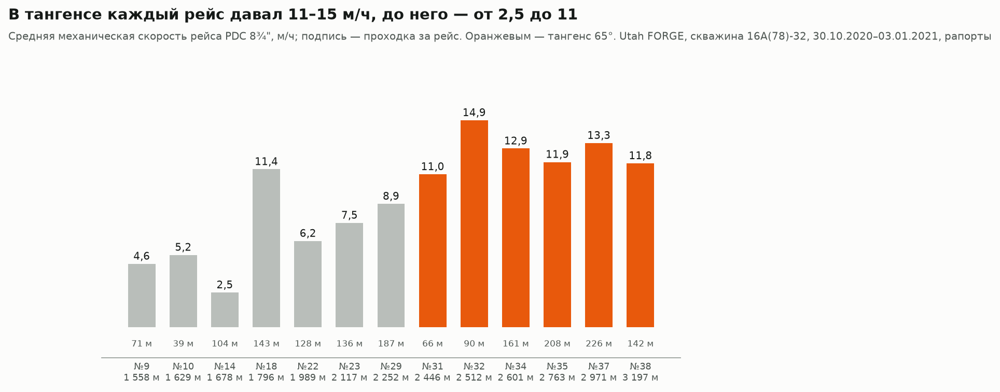
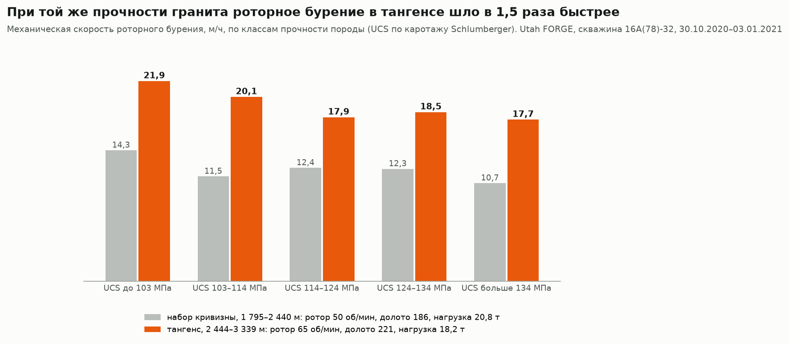
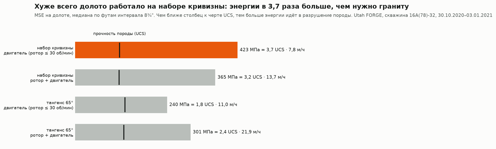
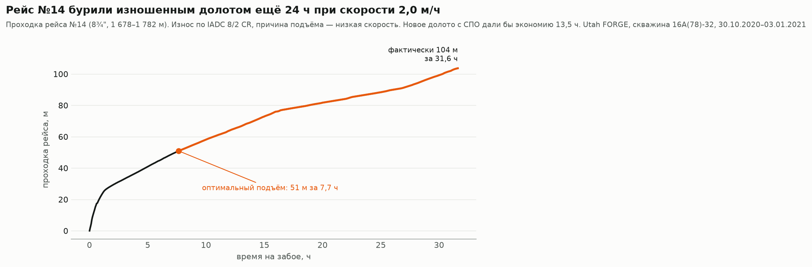
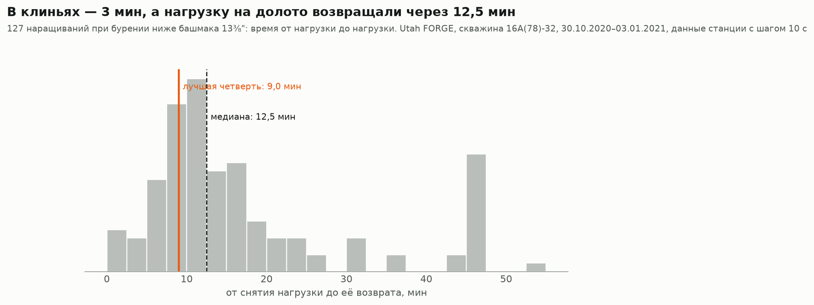
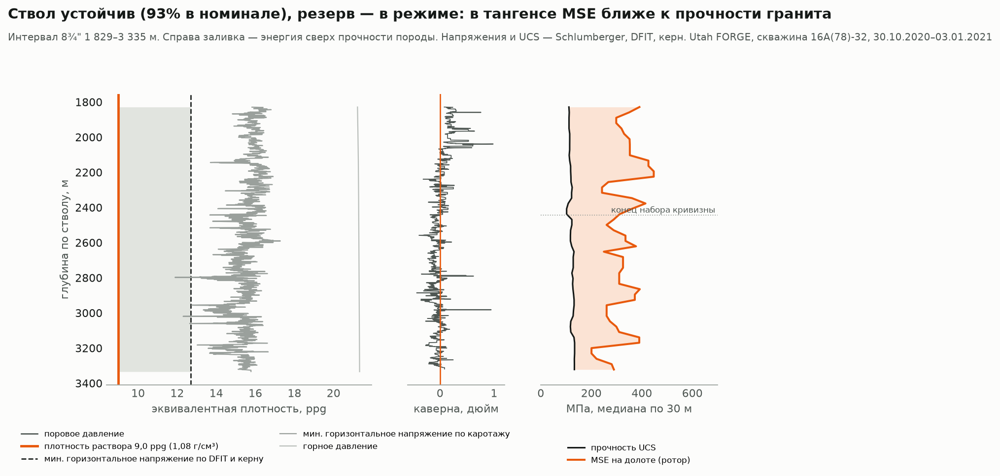

# Коммерческая скорость, MSE и геомеханика: скважина Utah FORGE 16A(78)-32

Разбор строительства скважины 16A(78)-32 так, как его разбирает руководитель проекта после окончания работ: куда ушло календарное время, где бурили эффективно, а где нет, был ли ствол устойчив и сколько суток можно было сэкономить. Ответ — в сутках и в коммерческой скорости.

Главный вывод: следующую эксплуатационную скважину в этом разрезе можно пробурить за **45,8 сут** вместо 60,9 — если убрать исследовательскую программу и применить пять мероприятий ниже.

Utah FORGE — испытательный полигон Министерства энергетики США для петротермальной энергетики: гранит, температура на забое больше 220 °C. Скважина 16A наклонная: вертикаль через 1,4 км осадочных пород, набор кривизны в граните до 2 444 м и тангенс до 3 349 м по стволу. Тангенс — прямолинейный участок после набора: угол больше не меняют, ствол идёт под 65° к вертикали, и бурят в основном ротором (78% метров). Пробурена в октябре — декабре 2020 года станком Frontier Rig 16, на 60 суток раньше плана.

**Данные:** суточные рапорты (75 суток), параметры станции с шагом 10 с (608 тыс. строк: нагрузка, обороты, момент, давление, перепад на двигателе), инклинометрия, каротаж и расчёт механических свойств пород Schlumberger. Все данные открыты: [Geothermal Data Repository](https://gdr.openei.org/submissions/1283), [каротаж](https://gdr.openei.org/submissions/1292), лицензия CC BY 4.0.
**Стек:** Python (pandas, NumPy, matplotlib) · разбор PDF-рапортов (pdfplumber) · LAS (lasio) · DuckDB.
**Автор:** Александр Царегородский, 10 лет в строительстве скважин.

🖥 [Презентация (PDF)](presentation/Presentation_FORGE_16A.pdf) · 📊 [Таблицы результатов](out) · 🧭 [Код](src/forge)

## Главное

| | Сутки | Коммерческая скорость, м/ст.-мес. |
|---|---|---|
| Факт: от забуривания до цементирования хвостовика | 60,9 | 1 651 |
| Без программы исследований FORGE (керн, ГИС, термометрия, DFIT) | 50,6 | 1 987 |
| С пятью мероприятиями ниже | **45,8** | **2 194 (+10%)** |

Скважину пробурили хорошо: на долоте энергия расходовалась нормально, ствол устойчив, НПВ — 4% времени. Резерв не в геологии и не в аварийности, а в организации рейсов: СПО и смена КНБК заняли 15,2 сут — больше, чем само бурение (13,9 сут).



## 1. Баланс календарного времени



Время разнесено по видам работ по кодам и тексту суточных рапортов. Исследования FORGE — 10,3 сут (17%): отбор керна, ГИС, температурные замеры, испытания на приёмистость с пакером, гироскопическая инклинометрия. У производственной скважины их не было бы, поэтому дальше скорость сравнивается с вариантом «как производственная скважина».

НПВ по ремонту и авариям — 2,6 сут: модули бурового насоса, гидравлика верхнего привода и захвата, промыв бурильной колонны, фрезерование обломков долота. Ещё 3,2 сут — промывки, в основном охлаждение ствола перед спуском приборов: для горячей скважины это часть технологии, а не потеря.



## 2. Механическая скорость в граните



Гранит прочный: UCS 105–138 МПа (10–90-й перцентиль) по расчёту Schlumberger. В тангенсе каждый рейс PDC давал 11–15 м/ч, до него — от 2,5 до 11 м/ч. Часть разницы объясняется профилем: на наборе кривизны долото работает с двигателем в ориентированном режиме, и это всегда медленнее. Поэтому дальше сравнивается только роторное бурение.



При одинаковой прочности породы роторное бурение в тангенсе шло в 1,5 раза быстрее: 18,5 м/ч против 12,2. Нагрузку снизили с 20,8 до 18,2 т, обороты ротора подняли с 50 до 65 об/мин, обороты долота — с 186 до 221. Для PDC в твёрдой породе это ожидаемо: при перегрузе резцы врезаются глубже, чем порода успевает скалываться, растут вибрации и износ. Если бы режим тангенса применили с начала интервала, бурение на наборе кривизны заняло бы на 10 ч меньше.

## 3. MSE: эффективно ли работало долото

MSE (механическая удельная энергия, Teale, 1965) — энергия, которую тратят на разрушение единицы объёма породы. Её сравнивают с прочностью породы на одноосное сжатие (UCS): в идеале MSE стремится к UCS, тогда вся энергия идёт в разрушение. Если MSE в разы выше — энергия уходит в вибрации, трение, сальник и износ резцов.

Долото крутят по-разному в зависимости от режима:

- **Ротор + двигатель.** Колонну вращает верхний привод, а забойный двигатель добавляет свои обороты. Обороты долота = обороты ротора + обороты двигателя (по расходу), момент на долоте — момент двигателя, который станция Pason считает по перепаду давления.
- **Ориентированное бурение (слайд).** Колонна не вращается или вращается медленно (до 30 об/мин), долото крутит только двигатель. Так набирают кривизну.

Поэтому MSE на долоте считалась по оборотам долота и моменту двигателя, а не по поверхностным параметрам. MSE по поверхности (момент на роторе) в наклонном стволе растёт с глубиной вместе с моментом на роторе — с 4,8 до 14,1 тыс. фут·фунт: это трение колонны о стенки, а не работа долота.



| Интервал 8¾", медиана по футам | MSE на долоте, МПа | UCS, МПа | MSE / UCS | Мех. скорость, м/ч |
|---|---|---|---|---|
| Набор кривизны, слайд | 423 | 115 | 3,7 | 7,8 |
| Набор кривизны, ротор + двигатель | 365 | 114 | 3,2 | 13,7 |
| Тангенс, ротор + двигатель | 301 | 127 | 2,4 | 21,9 |
| Тангенс, слайд (корректировка направления) | 240 | 130 | 1,8 | 11,0 |

- В тангенсе ротором MSE — 2,4 UCS, КПД долота около 40%. Для PDC в граните это рабочий уровень: в методике Dupriest рабочим считается КПД около 35%.
- На наборе кривизны долото тратило энергии больше в обоих режимах: 3,2–3,7 UCS. Порода там не прочнее (115 МПа против 127), значит, дело в режиме: нагрузка 21 т при 50 об/мин ротора (см. раздел 2).
- Если на наборе снизить MSE до уровня тангенса, механическая скорость роторного бурения там вырастет примерно на 10 ч бурения (оценка раздела 2).

## 4. Отработка долот



Для каждого рейса найдена точка подъёма, при которой минимально время на метр с учётом СПО: (время бурения + время СПО) / проходка. Время СПО — 2 × глубина / 640 м/ч (медиана чистого спуска по рапортам) плюс 3 ч на смену КНБК.

Важно учесть керн: скважина исследовательская, и долота поднимали не по износу, а по программе — на точки отбора керна, ГИС и исследования. По разметке рапортов из 14 рейсов в интервале 8¾" один — керновый, два закончены под смену КНБК, остальные (кроме рейса №14, о нём ниже) — на точки керна и исследований. Поэтому средняя проходка на рейс показывает программу исследований, а не ресурс долота, и для оценки отработки сравнивается скорость в начале и в конце рейса.

Все рейсы, кроме одного, подняли раньше износа: скорость в конце рейса была как в начале. Исключение — рейс №14 в вертикали: 51 м прошли за 7,7 ч, потом ещё 24 ч бурили со скоростью 2 м/ч. Оценка износа по IADC — 8/2 CR, причина подъёма — низкая скорость. Подъём в оптимуме сэкономил бы 13,5 ч.

Средняя проходка на рейс PDC 8¾" — 131 м, у трёх лучших рейсов — 207 м. При такой проходке 1 700 м интервала прошли бы за 9 рейсов вместо 13: при 10 ч на СПО это 40 ч, 1,7 сут.

## 5. Наращивания



127 наращиваний при бурении ниже башмака 13⅜" найдены по данным станции. От снятия нагрузки до её возврата — медиана 12,5 мин. Из чего она складывается (медианы, мин):

| Этап | Все | 12¼" (41) | 8¾" (86) |
|---|---|---|---|
| От снятия нагрузки до клиньев (проработка свечи) | 2,0 | 2,2 | 2,0 |
| В клиньях (работа бригады) | 3,0 | 3,5 | 2,8 |
| От выхода из клиньев до нагрузки на забое | 5,8 | 7,0 | 4,8 |
| **Итого** | **12,5** | **14,8** | **10,9** |

- Бригада в клиньях работает быстро — 3 мин. Резерв не в ней.
- Самая длинная часть — после клиньев: 5,8 мин. Из них 3,7 мин колонна стоит без движения с включёнными насосами. Вероятно, это замер инклинометрии телесистемой на каждой свече, но частота замеров по данным не проверена — это предположение.
- В 12¼" перед клиньями в 85% наращиваний свечу прорабатывали с вращением.
- Среднее (17,3 мин) больше медианы из-за длинного хвоста: каждое четвёртое наращивание дольше 20 мин, самое долгое — 55 мин.

Если бы все наращивания укладывались в 9 мин (лучшая четверть), экономия составила бы 19 ч.

## 6. Геомеханика



Интервал 8¾" (1 829–3 335 м) по расчёту Schlumberger: поровое давление 9,0 ppg (1,08 г/см³), минимальное горизонтальное напряжение 15,7 ppg по каротажу и 12,7–15,0 ppg (1,52–1,80 г/см³) по DFIT и керну, горное давление 21,3 ppg. Бурили на растворе 9,0 ppg, ECD 9,26 ppg.

- **Окно плотности широкое:** от порового давления до минимального напряжения больше 3,5 ppg. Поглощения и гидроразрыва при таком растворе быть не могло.
- **Ствол устойчив:** по каверномеру 93% интервала в пределах ±6 мм от номинала, увеличение больше 12 мм — 2%. Гранит с UCS 122 МПа и углом трения 23° держит стенки при растворе на уровне порового давления.
- **Ограничение было выше:** FIT на башмаке 13⅜" — 9,5 ppg, на башмаке 9⅝" — 9,6 ppg. Утяжелять раствор было некуда, но и не требовалось.

Правая панель связывает геомеханику с MSE: прочность гранита по глубине почти постоянна (110–130 МПа), а энергия на долоте сверх прочности (заливка) больше всего на наборе кривизны, до 2 444 м. Значит, резерв скорости — в режиме бурения, а не в породе.

Вывод: потери времени в этой скважине не связаны с устойчивостью ствола. Проработки (3,6 сут) по рапортам — подготовка ствола к ГИС и хвостовику и очистка наклонного ствола с остановками ротора по моменту, а не обвалы.

## Мероприятия

1. **Контроль MSE на долоте — с первого рейса PDC в граните.** На экране бурильщика — MSE на долоте и UCS по проекту (по соседней скважине). Правила:

    - MSE ≤ 2,5 UCS — режим нормальный, держать;
    - MSE 2,5–3,5 UCS — снизить нагрузку на 2–3 т, поднять обороты ротора на 10–15 об/мин, через 3 м сравнить MSE;
    - MSE > 3,5 UCS дольше 3 м или рост MSE при той же породе — признак вибраций или износа: проверить вибрации по телесистеме, сделать тест «нагрузка — скорость», при отсутствии эффекта — подъём по правилу п. 2.

    Для этой скважины это означает режим тангенса (18 т, 65 об/мин ротора) с начала интервала: −10 ч.

2. **Подъём долота по времени на метр.** На каждом метре считать среднее время на метр рейса с учётом СПО: (часы бурения в рейсе + время СПО) / проходка. Поднимать, когда текущее время на метр (последние 3 м) больше этого среднего. Время СПО для расчёта — 2 × глубина / 640 м/ч + 3 ч на КНБК. Для рейса №14 подъём выпал бы после 51 м: −13,5 ч.

3. **Длиннее рейсы.** В эксплуатационной скважине нет точек отбора керна, поэтому цель — проходка на рейс не меньше, чем у трёх лучших рейсов (200+ м): 9 рейсов вместо 13, −40 ч.

4. **Наращивания по регламенту, до 9 мин от нагрузки до нагрузки:** проработка свечи — только при затяжках, замер телесистемой — по программе (не на каждой свече, если не требует профиль), выход на режим сразу после замера; ежедневный отчёт «от нагрузки до нагрузки» по вахтам. −19 ч.

5. **ППР бурового насоса, верхнего привода и захвата трубного манипулятора** до забуривания: их ремонт — 24,5 ч, около 40% НПВ.

## Ограничения

- Режим бурения (ротор + двигатель или слайд) определён по оборотам ротора: до 30 об/мин — слайд. Отдельного признака слайда в данных станции нет.
- Виды работ размечены по кодам и тексту рапортов правилами: отдельные операции могут быть отнесены неточно, особенно когда в одной строке рапорта несколько работ.
- Энергия двигателя в MSE на долоте взята по моменту, который система Pason считает по перепаду давления; характеристик двигателя в данных нет.
- Время СПО в расчётах — модель (скорость спуска и время на КНБК), а не факт по каждому рейсу.
- Сравнение режимов — по одной скважине: на результат влияют не только нагрузка и обороты, но и модель долота.
- Метки времени в данных станции записаны с точностью до минуты; секунды восстановлены по порядку строк (6 строк в минуту).

## Как устроен проект

```
src/forge/reports.py      суточные рапорты PDF -> операции, долота, сутки
src/forge/balance.py      баланс календарного времени по видам работ
src/forge/drilling.py     данные станции 10 с -> показатели по каждому футу, MSE на поверхности и на долоте
src/forge/runs.py         рейсы долот: проходка, скорость, MSE, прочность породы
src/forge/connections.py  наращивания: в клиньях и от нагрузки до нагрузки
src/forge/geomech.py      окно плотности и каверномер по каротажу Schlumberger
src/forge/analysis.py     резерв времени по мероприятиям и коммерческая скорость
src/forge/figures.py      графики
```

Исходных данных в репозитории нет (около 300 МБ): скачать по ссылкам выше в `data/raw/`, затем `make all`.
