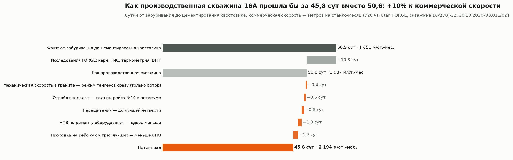
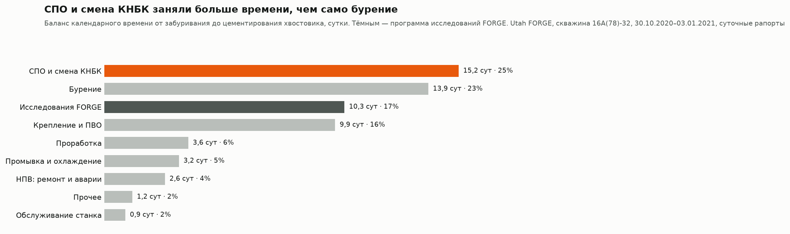
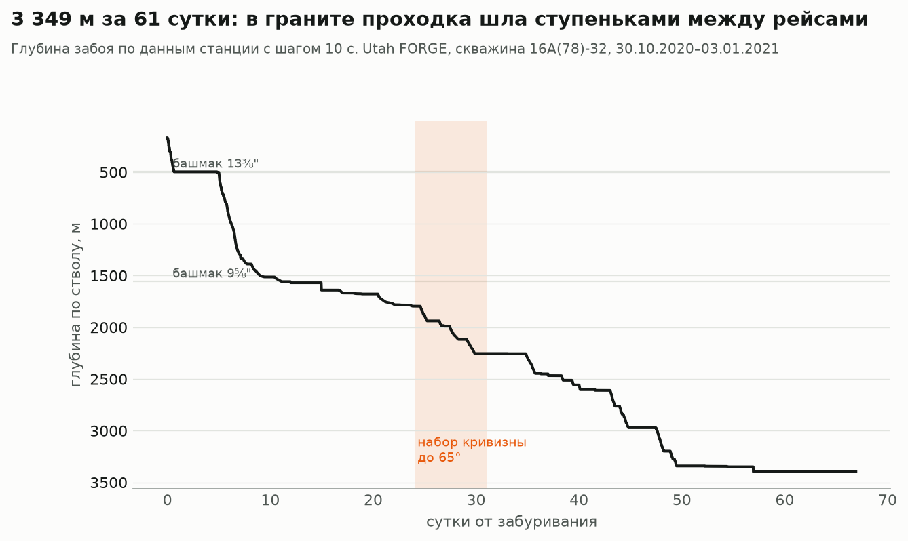
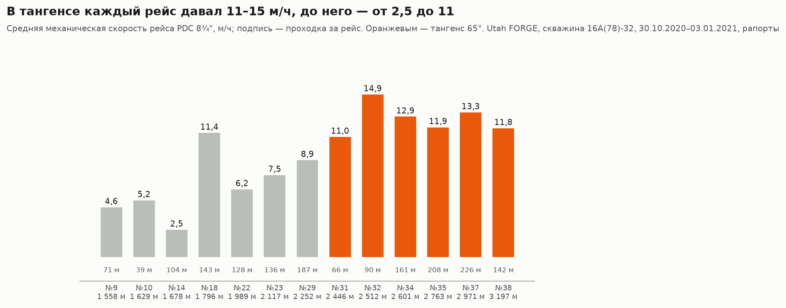
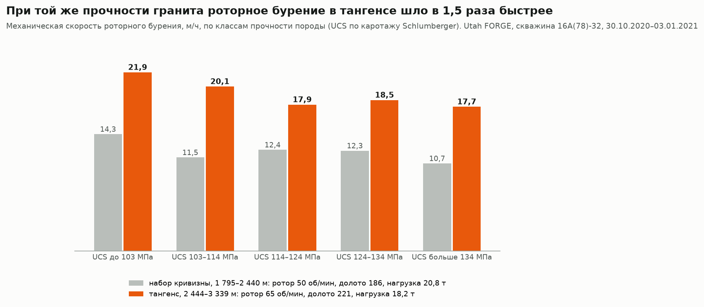
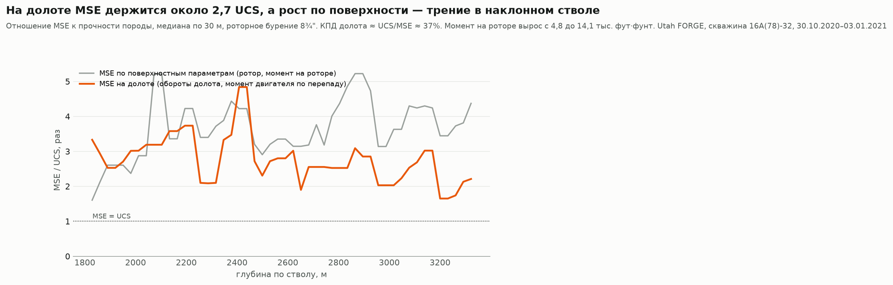
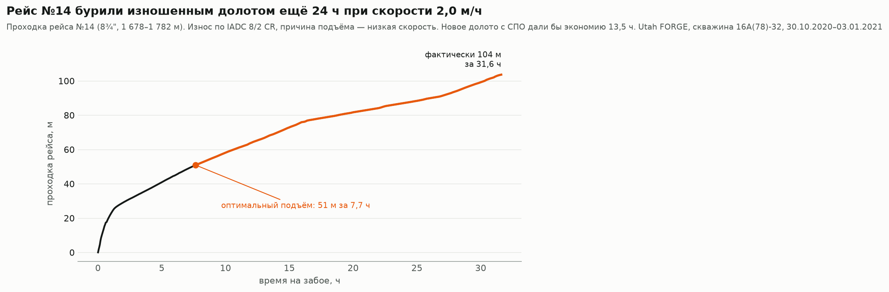
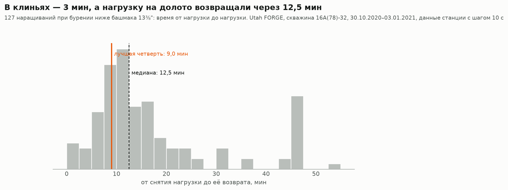
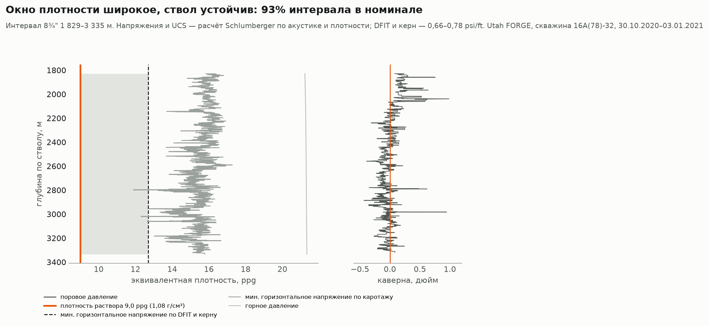

# Коммерческая скорость, MSE и геомеханика: скважина Utah FORGE 16A(78)-32

Разбор строительства скважины 16A(78)-32 так, как его разбирает руководитель проекта после окончания работ: куда ушло календарное время, где бурили эффективно, а где нет, был ли ствол устойчив и сколько суток можно было сэкономить. Ответ — в сутках и в коммерческой скорости.

Utah FORGE — испытательный полигон Министерства энергетики США для петротермальной энергетики: гранит, температура на забое больше 220 °C. Скважина 16A наклонная: вертикаль через 1,4 км осадочных пород, набор кривизны в граните и тангенс 65° до 3 349 м по стволу. Пробурена в октябре — декабре 2020 года станком Frontier Rig 16, на 60 суток раньше плана.

**Данные:** суточные рапорты (75 суток), параметры станции с шагом 10 с (608 тыс. строк: нагрузка, обороты, момент, давление, перепад на двигателе), инклинометрия, каротаж и расчёт механических свойств пород Schlumberger. Все данные открыты: [Geothermal Data Repository](https://gdr.openei.org/submissions/1283), [каротаж](https://gdr.openei.org/submissions/1292), лицензия CC BY 4.0.
**Стек:** Python (pandas, NumPy, matplotlib) · разбор PDF-рапортов (pdfplumber) · LAS (lasio) · DuckDB.
**Автор:** Александр Царегородский, 10 лет в строительстве скважин.

🖥 [Презентация (PDF)](presentation/Presentation_FORGE_16A.pdf) · 📊 [Таблицы результатов](out) · 🧭 [Код](src/forge)

## Главное

| | Сутки | Коммерческая скорость, м/ст.-мес. |
|---|---|---|
| Факт: от забуривания до цементирования хвостовика | 60,9 | 1 651 |
| Без программы исследований FORGE (керн, ГИС, термометрия, DFIT) | 50,6 | 1 987 |
| С пятью мероприятиями ниже | **45,8** | **2 194 (+10%)** |

Скважину пробурили хорошо: на долоте энергия расходовалась нормально, ствол устойчив, НПВ — 4% времени. Резерв не в геологии и не в аварийности, а в организации рейсов: СПО и смена КНБК заняли 15,2 сут — больше, чем само бурение (13,9 сут).



## 1. Баланс календарного времени



Время разнесено по видам работ по кодам и тексту суточных рапортов. Исследования FORGE — 10,3 сут (17%): отбор керна, ГИС, температурные замеры, испытания на приёмистость с пакером, гироскопическая инклинометрия. У производственной скважины их не было бы, поэтому дальше скорость сравнивается с вариантом «как производственная скважина».

НПВ по ремонту и авариям — 2,6 сут: модули бурового насоса, гидравлика верхнего привода и захвата, промыв бурильной колонны, фрезерование обломков долота. Ещё 3,2 сут — промывки, в основном охлаждение ствола перед спуском приборов: для горячей скважины это часть технологии, а не потеря.



## 2. Механическая скорость в граните



Гранит прочный: UCS 105–138 МПа (10–90-й перцентиль) по расчёту Schlumberger. В тангенсе каждый рейс PDC давал 11–15 м/ч, до него — от 2,5 до 11 м/ч. Часть разницы объясняется профилем: на наборе кривизны долото работает с двигателем в ориентированном режиме, и это всегда медленнее. Поэтому дальше сравнивается только роторное бурение.



При одинаковой прочности породы роторное бурение в тангенсе шло в 1,5 раза быстрее: 18,5 м/ч против 12,2. Нагрузку снизили с 20,8 до 18,2 т, обороты ротора подняли с 50 до 65 об/мин, обороты долота — с 186 до 221. Для PDC в твёрдой породе это ожидаемо: при перегрузе резцы врезаются глубже, чем порода успевает скалываться, растут вибрации и износ. Если бы режим тангенса применили с начала интервала, бурение на наборе кривизны заняло бы на 10 ч меньше.

## 3. MSE: эффективно ли работало долото

MSE (механическая удельная энергия, Teale, 1965) — энергия, которую долото тратит на разрушение единицы объёма породы. Если MSE близка к прочности породы, вся энергия идёт в разрушение; если в разы выше — энергия уходит в вибрации, сальник, износ или трение.



MSE считалась двумя способами:
- **По поверхностным параметрам** (обороты и момент на роторе). В наклонном стволе она растёт с глубиной с 2,5 до 4,5 UCS. Но растёт вместе с моментом на роторе (с 4,8 до 14,1 тыс. фут·фунт): это трение колонны о стенки, а не работа долота.
- **На долоте** (обороты долота, момент двигателя по перепаду давления). Медиана — 2,7 UCS, КПД около 37%. Это нормальный уровень для PDC: в методике Dupriest КПД 35% считается рабочим. На наборе кривизны MSE на долоте выше, 3–5 UCS, и именно там скорость была ниже.

Вывод для проекта: MSE по поверхности в наклонной скважине нельзя сравнивать между глубинами без поправки на трение. Нужен момент на долоте или хотя бы тренд MSE внутри одного рейса.

## 4. Отработка долот



Для каждого рейса найдена точка подъёма, при которой минимально время на метр с учётом СПО: (время бурения + время СПО) / проходка. Время СПО — 2 × глубина / 640 м/ч (медиана чистого спуска по рапортам) плюс 3 ч на смену КНБК.

Все рейсы, кроме одного, подняли раньше износа: скорость в конце рейса была как в начале. Это подъёмы на точки отбора керна, под смену компоновки или по температуре телесистемы. Исключение — рейс №14 в вертикали: 51 м прошли за 7,7 ч, потом ещё 24 ч бурили со скоростью 2 м/ч. Оценка износа по IADC — 8/2 CR, причина подъёма — низкая скорость. Подъём в оптимуме сэкономил бы 13,5 ч.

Средняя проходка на рейс PDC 8¾" — 131 м, у трёх лучших рейсов — 207 м. При такой проходке 1 700 м интервала прошли бы за 9 рейсов вместо 13: при 10 ч на СПО это 40 ч, 1,7 сут.

## 5. Наращивания



127 наращиваний при бурении найдены по данным станции. В клиньях — медиана 3 мин, то есть работа буровой бригады быстрая. Но от снятия нагрузки до её возврата — 12,5 мин: проработка перед наращиванием, замер телесистемой, выход на режим. Если бы все наращивания укладывались в 9 мин (лучшая четверть), экономия составила бы 19 ч.

## 6. Геомеханика



Интервал 8¾" (1 829–3 335 м) по расчёту Schlumberger: поровое давление 9,0 ppg (1,08 г/см³), минимальное горизонтальное напряжение 15,7 ppg по каротажу и 12,7–15,0 ppg (1,52–1,80 г/см³) по DFIT и керну, горное давление 21,3 ppg. Бурили на растворе 9,0 ppg, ECD 9,26 ppg.

- **Окно плотности широкое:** от порового давления до минимального напряжения больше 3,5 ppg. Поглощения и гидроразрыва при таком растворе быть не могло.
- **Ствол устойчив:** по каверномеру 93% интервала в пределах ±6 мм от номинала, увеличение больше 12 мм — 2%. Гранит с UCS 122 МПа и углом трения 23° держит стенки при растворе на уровне порового давления.
- **Ограничение было выше:** FIT на башмаке 13⅜" — 9,5 ppg, на башмаке 9⅝" — 9,6 ppg. Утяжелять раствор было некуда, но и не требовалось.

Вывод: потери времени в этой скважине не связаны с устойчивостью ствола. Проработки (3,6 сут) по рапортам — подготовка ствола к ГИС и хвостовику и очистка наклонного ствола с остановками ротора по моменту, а не обвалы.

## Мероприятия

1. **Режим бурения PDC в граните** — с первого рейса: меньше нагрузка, выше обороты, контроль MSE на долоте внутри рейса.
2. **Отработка долот по времени на метр.** Подъём, когда текущее время на метр превышает среднее с учётом СПО. Для рейса №14 — после 51 м.
3. **Длиннее рейсы.** В производственной скважине нет точек отбора керна, поэтому цель — проходка на рейс не меньше, чем у трёх лучших рейсов (200+ м).
4. **Наращивания по регламенту:** проработка и замер в пределах 9 мин, ежедневный отчёт «от нагрузки до нагрузки» по вахтам.
5. **ППР бурового насоса, верхнего привода и захвата трубного манипулятора** до забуривания: их ремонт — 24,5 ч, около 40% НПВ.

## Ограничения

- Виды работ размечены по кодам и тексту рапортов правилами: отдельные операции могут быть отнесены неточно, особенно когда в одной строке рапорта несколько работ.
- Энергия двигателя в MSE на долоте взята по моменту, который система Pason считает по перепаду давления; характеристик двигателя в данных нет.
- Время СПО в расчётах — модель (скорость спуска и время на КНБК), а не факт по каждому рейсу.
- Сравнение режимов — по одной скважине: на результат влияют не только нагрузка и обороты, но и модель долота.
- Метки времени в данных станции записаны с точностью до минуты; секунды восстановлены по порядку строк (6 строк в минуту).

## Как устроен проект

```
src/forge/reports.py      суточные рапорты PDF -> операции, долота, сутки
src/forge/balance.py      баланс календарного времени по видам работ
src/forge/drilling.py     данные станции 10 с -> показатели по каждому футу, MSE на поверхности и на долоте
src/forge/runs.py         рейсы долот: проходка, скорость, MSE, прочность породы
src/forge/connections.py  наращивания: в клиньях и от нагрузки до нагрузки
src/forge/geomech.py      окно плотности и каверномер по каротажу Schlumberger
src/forge/analysis.py     резерв времени по мероприятиям и коммерческая скорость
src/forge/figures.py      графики
```

Исходных данных в репозитории нет (около 300 МБ): скачать по ссылкам выше в `data/raw/`, затем `make all`.
